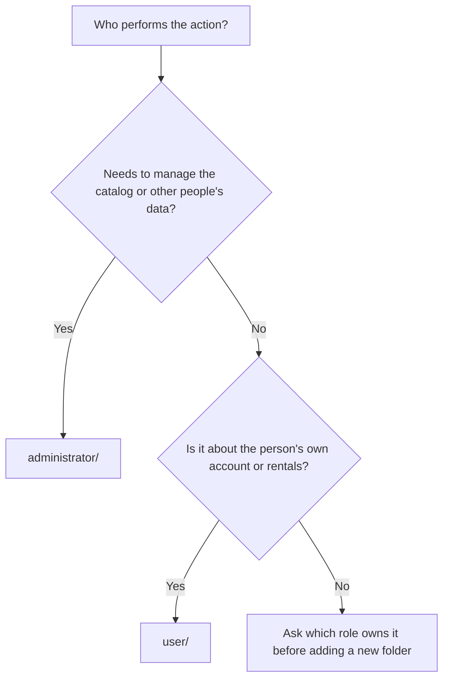
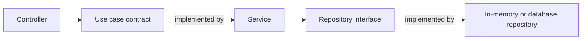

# Use Cases

This folder holds the **use case contracts** of the **MYCAR** car rental platform. A use case describes _what the system can do_ for a given kind of person, without saying _how_ it does it.

Every use case lives in the folder of the person who performs it. Pick your role below and jump straight in.

---

## Where do you want to go?

| I want to see what...                                                        | Go to                                |
| ---------------------------------------------------------------------------- | ------------------------------------ |
| **An administrator** can do: manage cars, categories and the catalog         | [`administrator/`](./administrator/) |
| **A regular user** can do: sign up, sign in and use the platform as a client | [`user/`](./user/)                   |

Not sure which one? Use this guide:



A simple rule of thumb: if the action needs the `admin` role, it belongs in `administrator/`. Everything a client does for themselves belongs in `user/`.

---

### `administrator/`

Use cases that only a user with the `admin` role can perform. They manage the data that every client sees.

Planned: update a car, update a category, manage reservations, manage users, approve testimonials.

### `user/`

Use cases performed by a regular person on the platform, starting with getting an account.

Planned: browse and search cars, filter by category, manage favourites, book and cancel rentals, leave a testimonial, subscribe to the newsletter.

---

## How a use case is organized

A use case file exports two things: the **contract** (an interface) and the **params** it receives.

```ts
export type createACarUsecaseParams = {
  name: string;
  brand: string;
  image?: string;
  pricePerDay: number;
  categoryId: string;
};

export interface createACarUsecase {
  execute(params: createACarUsecaseParams): Promise<Car>;
}
```

The actual logic is written elsewhere, in a **service** that implements the contract.



| Layer        | Folder          | Responsibility                                                   |
| ------------ | --------------- | ---------------------------------------------------------------- |
| Controller   | `controllers/`  | Receives the HTTP request and answers with the right status code |
| **Use case** | **`usecases/`** | **Defines what the system can do (this folder)**                 |
| Service      | `services/`     | Implements the use case and applies the business rules           |
| Repository   | `repositories/` | Reads and writes data                                            |
| Entity       | `entities/`     | Models the data and its own rules                                |

Keeping the contract apart from the service means a service can be replaced, or a test double used, without changing whoever calls it.

---

## Naming Conventions

| Item             | Pattern                        | Example                   |
| ---------------- | ------------------------------ | ------------------------- |
| Use case file    | `verbAnEntity.ts` in camelCase | `createACar.ts`           |
| Contract         | `verbAnEntityUsecase`          | `createACarUsecase`       |
| Params           | `verbAnEntityUsecaseParams`    | `createACarUsecaseParams` |
| Service          | `VerbAnEntityService`          | `CreateACarService`       |
| Service instance | `verbAnEntityService`          | `createACarService`       |

---

## Adding a New Use Case

1. **Choose the folder** with the guide above: `administrator/` or `user/`.
2. **Create the contract** in a new file, exporting the `...Usecase` interface and the `...UsecaseParams` type.
3. **Write the service** in `services/` implementing that interface.
4. **Add the repository methods** it needs, in the interface and in each implementation.
5. **Add the controller function** and register the route.
6. **Write the tests** in `src/vitest/services/`, covering success, invalid input, not found errors and side effects.
7. **Update this README** and the README of the folder you used.

---
