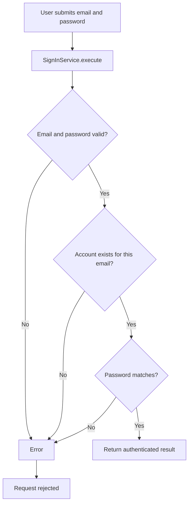

# Sign In Use Case

Authenticates an existing user of the **MYCAR** car rental platform. A user provides their email and password, the system checks them against the registered account, and the user is granted access when the credentials match.

---

## Table of Contents

- [Overview](#overview)
- [Input](#input)
- [Output](#output)
- [Business Rules](#business-rules)
- [Flow](#flow)
- [Errors](#errors)
- [Usage](#usage)
- [HTTP API](#http-api)
- [Security Notes](#security-notes)

---

## Overview

|                   |                                                          |
| ----------------- | -------------------------------------------------------- |
| **Use case**      | Sign In                                                  |
| **Actors**        | Client, Administrator                                    |
| **Goal**          | Authenticate a registered user                           |
| **Entry point**   | `SignInService.execute(params)`                          |
| **Precondition**  | The user has already signed up                           |
| **Postcondition** | The user is authenticated; no data is created or changed |

The use case is implemented by `SignInService` and relies on the same user repository used by the [Sign Up](./README.md) use case.

---

## Input

| Field      | Type     | Required | Description                     |
| ---------- | -------- | -------- | ------------------------------- |
| `email`    | `string` | Yes      | Email used when signing up      |
| `password` | `string` | Yes      | Account password, in plain text |

```ts
type SignInParams = {
  email: string;
  password: string;
};
```

---

## Output

On success, the service returns the result of the authentication for the matching user.

Both clients and administrators sign in through the same use case. The user's `role` decides what they can do afterwards, not how they log in.

---

## Business Rules

1. **Both fields are required:** a missing email or password is rejected.
2. **Valid email format:** malformed emails (for example `vilenio@` or `@vikey.com`) are rejected.
3. **Registered email:** the email must belong to an existing account.
4. **Correct password:** the password must match the one stored for that account.
5. **Case-sensitive password:** `123456789aB` and `123456789ab` are different passwords.
6. **One account per credentials:** a password that belongs to another user never authenticates this one.
7. **Repeatable:** a user can sign in as many times as needed with the same credentials.
8. **No side effects:** signing in, successfully or not, never creates, changes or removes users.

---

## Flow



---

## Errors

Every failed sign in rejects the promise, so callers handle it with `try / catch`.

| Situation                    | Result   |
| ---------------------------- | -------- |
| Email or password missing    | Rejected |
| Malformed email              | Rejected |
| Email not registered         | Rejected |
| Wrong password               | Rejected |
| Password of a different user | Rejected |

Input problems can be reported as a `ValidationError`, which carries the offending `field` and a readable `message`.

```ts
class ValidationError extends Error {
  field: string;
  message: string;
}
```

---

## Usage

```ts
import { SignInService } from "@/services/user/SignInService";
import { InMemoryUserRepository } from "@/repositories/InMemory/InMemoryUserRepository";

const signInService = new SignInService(new InMemoryUserRepository());

try {
  const result = await signInService.execute({
    email: "vilenio@vikey.com",
    password: "123456789aB",
  });

  console.log(result);
} catch (error) {
  console.error("Invalid credentials");
}
```

A complete flow, signing up first and then signing in with the same repository:

```ts
const userRepository = new InMemoryUserRepository();
const signupService = new SignupService(userRepository);
const signInService = new SignInService(userRepository);

await signupService.execute({
  email: "vilenio@vikey.com",
  name: "Vilénio Kiala",
  phone: "923456789",
  password: "123456789aB",
});

await signInService.execute({
  email: "vilenio@vikey.com",
  password: "123456789aB",
});
```

---

## HTTP API

**Request**

```http
POST /signin
Content-Type: application/json
```

```json
{
  "email": "vilenio@vikey.com",
  "password": "123456789aB"
}
```

**Responses**

| Status | Meaning                    |
| ------ | -------------------------- |
| `200`  | Authenticated              |
| `400`  | Missing or malformed input |
| `401`  | Wrong email or password    |
| `500`  | Unexpected error           |

---

## Security Notes

- **Use one generic message for credential failures.** Answering "Invalid email or password" for both an unknown email and a wrong password stops attackers from discovering which emails are registered.
- **Never return the password.** Even when it is hashed, it must not appear in any response.
- **Compare passwords through the entity.** Verification goes through `user.comparePassword(...)`, never by comparing strings directly.
- **Limit login attempts.** Add rate limiting on the sign in route to slow down brute force attacks.
- **Use HTTPS in production.** Credentials travel in the request body.

---
