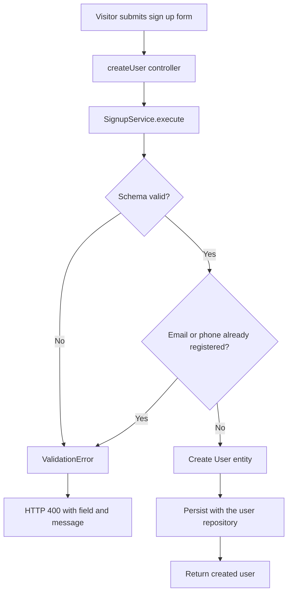

# Sign Up Use Case

Registers a new user in the **MYCAR** car rental platform. A visitor provides their personal details and credentials, the system validates them, and a new account is created as a **client** (or as an **administrator**, when explicitly requested).

---

## Table of Contents

- [Overview](#overview)
- [Input](#input)
- [Output](#output)
- [Business Rules](#business-rules)
- [Flow](#flow)
- [Errors](#errors)
- [Usage](#usage)
- [HTTP API](#http-api)

---

## Overview

|                   |                                                   |
| ----------------- | ------------------------------------------------- |
| **Use case**      | Sign Up                                           |
| **Actor**         | Visitor (no account yet)                          |
| **Goal**          | Create a new user account                         |
| **Entry point**   | `SignupService.execute(params)`                   |
| **Precondition**  | The email and phone number are not registered yet |
| **Postcondition** | A new `User` is persisted and returned            |

The use case is implemented by `SignupService` and exposed over HTTP by the `createUser` controller.

---

## Input

| Field      | Type       | Required | Description                            |
| ---------- | ---------- | -------- | -------------------------------------- |
| `email`    | `string`   | Yes      | Unique email address of the user       |
| `name`     | `string`   | Yes      | Full name                              |
| `phone`    | `string`   | Yes      | Unique phone number (e.g. `923456789`) |
| `password` | `string`   | Yes      | Account password                       |
| `role`     | `UserRole` | No       | `client` (default) or `admin`          |

```ts
type SignupParams = {
  email: string;
  name: string;
  phone: string;
  password: string;
  role?: UserRole;
};
```

---

## Output

On success, the service returns the created `User` entity.

| Property         | Description                          |
| ---------------- | ------------------------------------ |
| `id`             | Unique identifier                    |
| `email`          | Email address                        |
| `name`           | Full name                            |
| `phone`          | Phone number                         |
| `role`           | `client` or `admin`                  |
| `active`         | `true` for new accounts              |
| `emailConfirmed` | `false` until the email is confirmed |

The entity also exposes `comparePassword(password)`, used to verify a plain-text password against the stored one.

---

## Business Rules

1. **Valid data:** every field is validated against the user schema before anything is saved.
2. **Unique email:** two accounts cannot share the same email.
3. **Unique phone:** two accounts cannot share the same phone number.
4. **Strong password:** the password must satisfy the password rules defined in the schema.
5. **Default role:** when `role` is not provided, the user is created as `client`.
6. **Valid role:** only values from `UserRole` are accepted.
7. **New accounts are active:** `active` is `true` from the start.
8. **Email starts unconfirmed:** `emailConfirmed` is `false` on creation.
9. **Nothing is saved on failure:** if any validation fails, no user is persisted.

---

## Flow



---

## Errors

Validation failures throw a `ValidationError`, which carries the name of the offending field and a readable message.

```ts
class ValidationError extends Error {
  field: string;
  message: string;
}
```

| Situation                | `field`    | HTTP status |
| ------------------------ | ---------- | ----------- |
| Missing or invalid email | `email`    | 400         |
| Email already registered | `email`    | 400         |
| Missing or empty name    | `name`     | 400         |
| Missing or invalid phone | `phone`    | 400         |
| Phone already registered | `phone`    | 400         |
| Missing or weak password | `password` | 400         |
| Invalid role             | `role`     | 400         |
| Unexpected failure       | none       | 500         |

---

## Usage

```ts
import { SignupService } from "@/services/user/SignupService";
import { InMemoryUserRepository } from "@/repositories/InMemory/InMemoryUserRepository";
import { ValidationError } from "@/helpers/errors/ValidationError";

const signupService = new SignupService(new InMemoryUserRepository());

try {
  const user = await signupService.execute({
    email: "vilenio@vikey.com",
    name: "Vilénio Kiala",
    phone: "923456789",
    password: "123456789aB",
  });

  console.log(user.role);
} catch (error) {
  if (error instanceof ValidationError) {
    console.error(error.field, error.message);
  }
}
```

Creating an administrator:

```ts
import { UserRole } from "@/entities/User";

await signupService.execute({
  email: "admin@admin.com",
  name: "Administrator",
  phone: "923456739",
  password: "123456789aB",
  role: UserRole.ADMIN,
});
```

---

## HTTP API

The `createUser` controller wraps the service for Fastify.

**Request**

```http
POST /users
Content-Type: application/json
```

```json
{
  "email": "vilenio@vikey.com",
  "name": "Vilénio Kiala",
  "phone": "923456789",
  "password": "123456789aB",
  "role": "client"
}
```

**Responses**

| Status | Meaning           | Body                                     |
| ------ | ----------------- | ---------------------------------------- |
| `200`  | User created      | The created user                         |
| `400`  | Validation failed | `{ "field": "email", "message": "..." }` |
| `500`  | Unexpected error  | `Error creating user: <message>`         |

---
